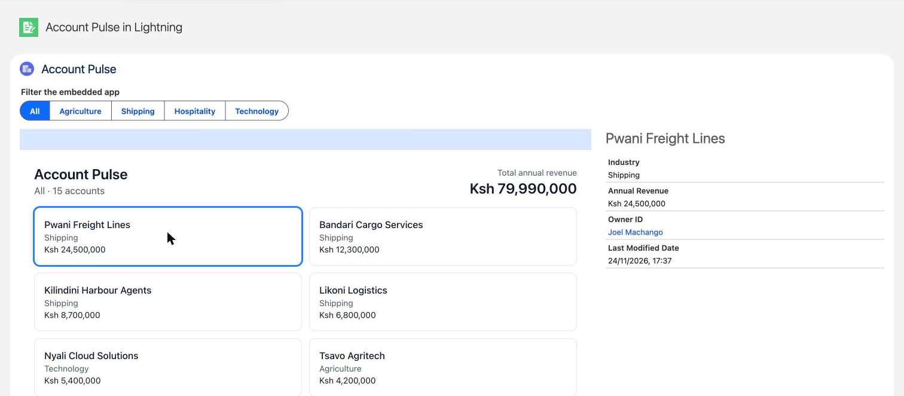

# Angular on Salesforce: Account Pulse

An Angular app that runs **inside Salesforce** with Salesforce Multi-Framework, built live at **DevFest Pwani 2026** (Mombasa, Nov 28).

It's based on the *Account Pulse* example in the Salesforce Developers Blog post [What's New in Salesforce Multi-Framework: Angular Is Now GA](https://developer.salesforce.com/blogs/2026/10/whats-new-in-salesforce-multi-framework-angular-is-now-ga) (Alice Oh and Charles Watkins, Oct 2026). Read it alongside this repo.



## New to Salesforce? A quick map from Google

| You know (Google) | Salesforce |
|---|---|
| Firebase / GCP project | **Org**: your own Salesforce instance (a free Developer Edition is one) |
| Firestore collection | **Object**, e.g. `Account` |
| Document | **Record** |
| Firebase Auth + Security Rules | Built-in sign-in, with object, field and sharing security **enforced on the server** |
| Firebase JS SDK | **Data SDK** (`@salesforce/platform-sdk`), which sends GraphQL to Salesforce's UI API |
| Lit (web components) | **Lightning Web Components (LWC)** |

## What the app does

- Reads Accounts with the Data SDK into Angular **signals**, and derives totals with `computed`.
- Formats revenue in the signed-in user's locale and currency (USD → **Ksh** by changing a Salesforce setting, not code).
- Runs on its own from the **App Launcher**, *and* embedded in a Lightning page:
  - a native radio group passes `{ industry }` **into** the Angular app (View SDK `getUiState`),
  - clicking an account sends `accountpulse.accountselected` **out**, and the page shows the record with native components.

## Run it yourself (about 15 minutes)

**You need:** Node.js 22+, the [Salesforce CLI](https://developer.salesforce.com/tools/salesforcecli), and a **fresh** free org.

> ⚠️ **Use a new, empty org.** `npm run setup` deletes **every Account** in the target org before loading the 15 demo Accounts. Never point it at an org with real data.

1. **Get a free org:** sign up at <https://developer.salesforce.com/signup>, then click the link in the welcome email and set a password.
2. **Connect the CLI:**
   ```bash
   sf org login web --alias angular-on-salesforce --set-default
   ```
3. **Clone and set up** (build, deploy, permissions, demo data, GraphQL types):
   ```bash
   git clone https://github.com/joelmachango/angular-on-salesforce.git
   cd angular-on-salesforce
   npm install
   npm run setup -- --target-org angular-on-salesforce --yes
   ```
4. **Open the app:** App Launcher (the grid icon, top left) → **Account Pulse**.
5. **Embed it in a Lightning page.** The embed needs your org's app address, which is different for every org:
   ```bash
   sf data query -q "SELECT StartUrl FROM AppMenuItem WHERE Name='accountpulse'"
   ```
   It looks like `https://<your-domain>--c.develop.my.salesforce.app/app/c__accountpulse`. Put it in two files:
   - `force-app/main/default/flexipages/Account_Pulse_Lightning.flexipage-meta.xml` → the `appUrl` value (full URL)
   - `force-app/main/default/cspTrustedSites/Account_Pulse_App.cspTrustedSite-meta.xml` → `endpointUrl` (origin only, no path)

   Then deploy and open the **Account Pulse in Lightning** tab:
   ```bash
   sf project deploy start --source-dir force-app
   ```
6. **Optional, Kenyan shillings:** Setup → Company Information → Currency Locale **English (Kenya) – KES** (leave *Activate Multiple Currencies* off). In your user settings, set Locale **English (Kenya)** and Time Zone **Africa/Nairobi**. Reload the app.

## Follow the talk step by step

Each slide step is a git tag with the same number: `git checkout step-5`.

| Slide | Tag | What it adds |
|---|---|---|
| Step 2 | `step-2` | Project created from the `angularinternalapp` template |
| Step 3 | `step-3` | Template extras removed; seed data added |
| Step 4 | `step-4` | Deploy (no code change: same commit as `step-3`) |
| Step 5 | `step-5` | Data SDK GraphQL → `accounts` signal → `@for` |
| Step 6 | `step-6` | `computed` filter and total |
| (aside) | `aside-currency` | Revenue in the user's currency (`@salesforce/platform-sdk/i18n`) |
| Step 7 | `step-7` | Host LWC + Lightning page: props in, events out |
| | `main` | Plus `loading` and `error` signals |

(Step 1, getting an org, has no code, so no tag.)

The code to read: `force-app/main/default/uiBundles/accountpulse/src/app/pages/account-pulse/` (Angular) and `force-app/main/default/lwc/accountPulseHost/` (the LWC host).

## Good to know

- **Internal app, separate domain.** The app is served from `*.salesforce.app`, a separate origin for security, but only your org's users can open it.
- **Client-side only:** no SSR and no server-held secrets. You own your npm dependencies.
- **Hyperforce orgs only.** New Developer Edition orgs qualify.
- **LWC changes not showing?** Hard-refresh the browser. Lightning caches components.
- Free Developer Edition orgs may be deleted after 45 days without a login.

## Learn more

- [Multi-Framework developer guide](https://developer.salesforce.com/docs/platform/multiframework/guide)
- [UI Embedding (Microfrontend) guide](https://developer.salesforce.com/docs/platform/microfrontend/guide/get-started.html)
- [Multi-Framework recipes](https://github.com/trailheadapps/multiframework-recipes), including the Angular and Microfrontend recipes
- [Trailhead](https://trailhead.salesforce.com), free Salesforce learning

The company names in the demo data are made up.
